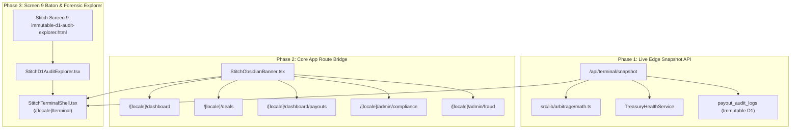

# `/mk-brainstorm` Delivery Contract — ApexOS Full Stitch Integration & Screen 9 Baton

## 1. Brainstorm Contract (4 Core Fields)

| Field | Specification |
|-------|---------------|
| **Outcome** | 1. **Phase 1 (Live Backend API Wiring):** Unified `/api/terminal/snapshot` edge endpoint & live/benchmark data toggle in `StitchTerminalShell.tsx` connecting Stitch components to `src/lib/arbitrage`, `src/lib/payouts/treasury-health-service.ts`, `src/lib/compliance`, and `src/lib/webhooks`. 2. **Phase 2 (Core App Route Bridge):** Reusable `StitchObsidianBanner.tsx` telemetry & deep-link bridge integrated into `/[locale]/dashboard`, `/[locale]/deals`, `/[locale]/dashboard/payouts`, `/[locale]/admin/compliance`, and `/[locale]/admin/fraud`. 3. **Phase 3 (Screen 9 Baton + Forensic D1 Audit Explorer):** Generate Screen 9 (`immutable-d1-audit-explorer.html`) via Google Stitch MCP (`projects/11542622336933833737`) and build `StitchD1AuditExplorer.tsx` inside the Next.js App Router Terminal suite. |
| **Constraints** | - Zero breaking changes to existing routes or Jest test suites. - Preserve `Readonly<Props>`, semantic HTML, ARIA attributes, and CSS token discipline (`design-tokens.css` / `stitch.*` Tailwind namespace). - `next-prompt.md` must advance cleanly to Screen 10 baton. |
| **Non-goals** | - No destructive database schema migrations or deletion of legacy dashboard components. - No hardcoded live private keys or unauthenticated mutations on production hot wallets. |
| **Acceptance Criteria** | - `docs/stitch-full-integration-plan.md` written and committed. - `/api/terminal/snapshot` returns live domain calculations with deterministic fallback. - Screen 9 (`immutable-d1-audit-explorer.html` & `.png`) synced into `queue/`, `site/public/`, and `StitchD1AuditExplorer.tsx`. - `npx tsc --noEmit` exits `0` and Jest tests pass 100%. |

---

## 2. Binh Pháp Strategic Trade-Off Matrix

| Approach | Thế (Leverage) | Hư Thực (Risk / Complexity) | Verdict |
|----------|----------------|-----------------------------|---------|
| **Phase 1: Live API Snapshot Endpoint (`/api/terminal/snapshot`)** | Connects `ArbitrageEngine`, `TreasuryHealthService`, and `payout_audit_logs` to `/[locale]/terminal` in a single round-trip with zero waterfall requests. | Low risk — deterministic fallback guarantees offline/CI resilience. | **Execute #1** |
| **Phase 2: Core Route Obsidian Bridge (`StitchObsidianBanner`)** | Surfaces live multi-chain circuit breaker telemetry and one-click deep links into `/[locale]/terminal?tab=...` across all 5 core routes without breaking existing page tests. | Zero regression risk to existing DOM selectors in legacy route tests. | **Execute #2** |
| **Phase 3: Stitch Baton Screen 9 (`immutable-d1-audit-explorer`)** | Completes the forensic compliance loop by visualizing SQLite `BEFORE UPDATE` / `BEFORE DELETE` immutability triggers on `payout_audit_logs` and SHA-256 Merkle batch verification. | Requires both Stitch MCP generation and Next.js component (`StitchD1AuditExplorer.tsx`). | **Execute #3** |

---

## 3. Execution Architecture

