# ApexOS Go-Live & Paper Trading Implementation Plan

> Target: Production Go-Live Readiness for Cashback & Greenfield Durable Objects Paper Trading Engine
> Reference: `plans/reports/advise-261030-2006-apexos-go-live-paper-trading-ultra.md`

## Summary
ApexOS requires two cohesive tracks: (1) Hardening & audit of the existing Cashback/Affiliate platform (environment isolation, secret purging, payout safety, crawler integrity, clean gates), and (2) Greenfield implementation of a real-market Paper Trading simulator powered by Cloudflare Workers and Durable Objects (ingesting live Binance & Bybit L2 orderbook feeds for BTC/USDT & ETH/USDT, running two independent 10,000 USDT strategies, maintaining an immutable replayable journal, and providing an honest admin console with `PAPER` watermarking and zero fake marketing claims).

## Architecture & Phasing

```mermaid
flowchart TD
  subgraph BlockA["Block A: Isolation & Security Hotfix"]
    A1["Purge HMAC Secret Literal"]
    A2["Separate Staging KV & R2"]
    A3["Remove Staging D1 from Prod Config"]
    A4["Expand assert-staging-isolation.sh"]
    A5["Strip Fake 12ms Claims"]
  end

  subgraph BlockB["Block B: Cashback Audit & Integrity"]
    B1["Enforce Stellar-Only Payout Rails for V1"]
    B2["Crawler Transparent Fallback Metadata"]
    B3["Verify Auth, Ledger & KYC $500 Threshold"]
    B4["Ensure AUTO_SETTLE_PAYOUTS=false"]
  end

  subgraph BlockC["Block C: CI Pipeline & Gate Hardening"]
    C1["Wire assert-staging-isolation into deploy:production"]
    C2["Update scripts/go-live-gate.sh (G0..G5 + G6..G7)"]
    C3["Wire Gate Verification in CI"]
  end

  subgraph BlockD["Block D: Greenfield Paper Trading Engine"]
    D1["Worker + Durable Objects Orderbook Sequencer"]
    D2["Binance & Bybit WS Feeds with Gap Detection"]
    D3["Two 10k USDT Strategies (Spot-2Exch & Spot-Perp)"]
    D4["Immutable Journal on D1 + Compressed Replay on R2"]
    D5["Admin Console: Realtime Terminal + Closed Cycles + CSV/PDF"]
  end

  subgraph BlockE["Block E: Final Verification & Cutover"]
    E1["Deterministic Replay Verification Test"]
    E2["Full Gate G0-G7 Execution on Release SHA"]
    E3["Descriptive Research Report Generation"]
  end

  BlockA --> BlockB --> BlockC --> BlockD --> BlockE
```

---

## Phases & Tasks

### Phase 1: Isolation & Security Hardening (Block A)
- [x] Task 1.1: Purge hardcoded HMAC secret literal in `src/app/api/terminal/snapshot/route.ts` and replace with `process.env.TERMINAL_HMAC_SECRET`. Remove fake `'LIVE_EDGE_SYNCED'` status and label route as DEMO/PAPER only.
- [x] Task 1.2: Remove `apex_os_staging_db` binding from `wrangler.jsonc` (production).
- [x] Task 1.3: Provision isolated KV namespace and R2 bucket IDs for staging in `wrangler.staging.jsonc` (`apex-os-kv-staging` and `apex-os-uploads-staging`).
- [x] Task 1.4: Expand `scripts/assert-staging-isolation.sh` to strictly verify distinct D1 IDs, distinct KV IDs, and distinct R2 bucket names between `wrangler.jsonc` and `wrangler.staging.jsonc`.
- [x] Task 1.5: Purge fabricated "12ms" latency claims across `src/components/stitch/StitchAiAgentArbitrageBot.tsx`, `src/data/stitch-terminal-data.ts`, and `public/stitch/screens/ai-agent-arbitrage-bot.html`.
- [x] Task 1.6: Add `bash scripts/assert-staging-isolation.sh` to `deploy:production` in `package.json`.

### Phase 2: Cashback Core Audit & Payout Rails Hardening (Block B)
- [x] Task 2.1: Enforce Stellar-only payout execution for V1 launch in `src/lib/payouts/router.ts` and `batch-settlement-service.ts`. Explicitly block non-Stellar chains (Ethereum, Solana) at the router level until future authorized phases.
- [x] Task 2.2: Fix crawler fallback in `src/lib/crawler/service.ts`: do NOT silently persist fallback fixture rate cards as active cards without provenance. Attach `data_source: 'fallback_fixture'` metadata and log warning.
- [x] Task 2.3: Verify KYC compliance enforcement: ensure payouts exceeding $500 require verified KYC status (`kyc_tier != 'none'`).
- [x] Task 2.4: Verify `AUTO_SETTLE_PAYOUTS` default is `false` across all environments; require manual admin review and approval for batch settlement.

### Phase 3: CI Pipeline & Gate Hardening (Block C)
- [x] Task 3.1: Update `scripts/go-live-gate.sh` to include KV and R2 isolation checks in G2, maintain existing G5 operational readiness check, and add G6 (Deterministic Replay & Paper Engine verification) and G7 (Production Deployment & SHA verification).
- [x] Task 3.2: Clean working tree and verify G0 passes with clean git status.
- [x] Task 3.3: Verify all Jest unit and integration tests pass on Node 26.7.0.

### Phase 4: Greenfield Paper Trading Engine (Block D)
- [x] Task 4.1: Scaffold Worker module with Durable Objects configuration for Orderbook Ingestion (`src/lib/paper/`).
- [x] Task 4.2: Implement `OrderbookDurableObject` managing L2 orderbooks for BTC/USDT and ETH/USDT on Binance (depth diff + `lastUpdateId` tracking) and Bybit v5 (`orderbook.1` snapshot/delta).
- [x] Task 4.3: Implement Sequencer gap detection: if sequence ID jumps or packets are lost, immediately flag `FEED_DESYNC` and halt opening of new paper cycles until resync.
- [x] Task 4.4: Implement two independent Strategy engines with distinct 10,000 USDT ledgers:
  - Strategy 1: Cross-Exchange Spot (Binance spot vs Bybit spot).
  - Strategy 2: Spot–Perpetual Basis / Funding.
- [x] Task 4.5: Calculate realistic taker fees (~0.2% round-trip) and book-depth slippage. If net spread after fees is negative, record as `NO_TRADE`.
- [x] Task 4.6: Implement Immutable Journal logging to D1 (`paper_trade_journal`) with deterministic idempotency keys and compressed replay references to R2 (`paper-replay`).
- [x] Task 4.7: Implement Admin Console endpoints and UI:
  - Realtime Terminal displaying feed latency, raw spread, net spread after fees.
  - Closed-Cycle Table displaying closed trades with entry, exit, fees, net P&L.
  - Export functionality (CSV/PDF) stamped with `PAPER`, `model_version`, and feed timestamp.

### Phase 5: Verification, Replay Testing & Cutover (Block E)
- [x] Task 5.1: Write replay regression test: re-execute a 50-tick sequence from R2 and assert 100% bit-identical journal P&L output.
- [x] Task 5.2: Run full `scripts/go-live-gate.sh` and ensure all gates pass on the release SHA.
- [x] Task 5.3: Ensure economic metrics report is generated as a descriptive research report without acting as a blocking deployment gate.

---

## Acceptance Criteria
1. Zero hardcoded secrets in source code (`grep -rn "apex_os_edge_hmac_secret" src/` returns 0).
2. Complete staging/production isolation across D1, KV, and R2 verified by `assert-staging-isolation.sh`.
3. Non-Stellar payout chains fail closed at the router level during V1 release.
4. Crawler fallback is explicitly tagged and distinguishable from live rate cards.
5. Greenfield Durable Object orderbook engine connects to live Binance & Bybit public feeds with gap detection.
6. Two paper trading strategies run independently with 10k USDT paper ledgers and taker fee deduction.
7. Replay test passes with 100% bit-identical P&L reproduction.
8. Admin console renders terminal, cycle table, and export with prominent `PAPER` indicators.
9. `scripts/go-live-gate.sh` passes completely on clean working tree.
10. `AUTO_SETTLE_PAYOUTS=false` enforced.
